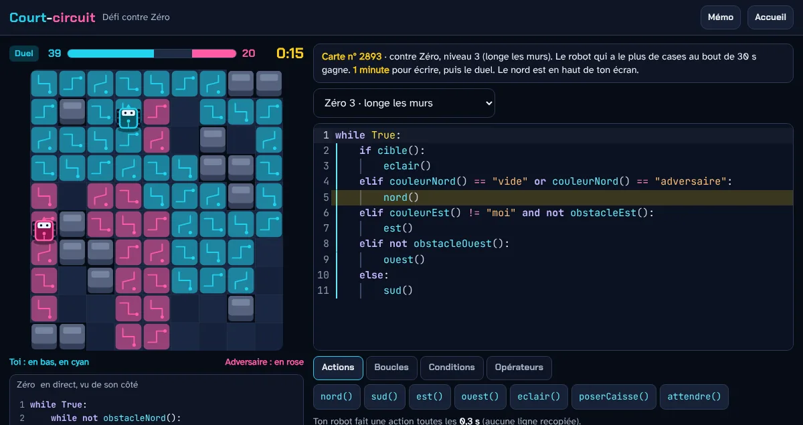

# ⚡ Court-circuit

**Les boucles et les conditions en Python, en duel de robots.** Pour la seconde, en SNT, et la 1re NSI.

> Tes élèves écrivent en Python le code d'un robot qui colorie le sol. Un `for` suffit pour commencer ; `while`, `if`, `and`, `not` et les comparaisons rendent le robot plus fort. Seul·e, contre Zéro (le robot de l'ordinateur) ou **en duel en direct contre un·e camarade** : une minute pour écrire son code, 30 secondes de duel, et le code de l'adversaire s'affiche pendant le match.

## 👉 [Essayer maintenant : babash.github.io/court-circuit](https://babash.github.io/court-circuit/)

**Gratuit · sans compte · rien à installer · aussi sur téléphone · rien n'est enregistré en ligne ; le prénom ou le pseudo passe seulement en direct dans la salle**

Court-circuit fait partie des [Ressources NSI et SNT](https://babash.github.io/Babash-NSI-SNT/), rubriques [SNT](https://babash.github.io/Babash-NSI-SNT/snt/) et [NSI Première](https://babash.github.io/Babash-NSI-SNT/nsi-premiere/).



---

## Une séance en trois étapes

1. **Tu** ouvres la [salle de classe](https://babash.github.io/court-circuit/prof.html) et la projettes : un code de 4 lettres, un lien et un QR code s'affichent.
2. **Les élèves** s'entraînent seul·e·s quelques minutes (6 cartes, 3 étoiles par carte), puis entrent dans la salle avec le QR code, le lien ou le code, et un prénom ou un pseudo.
3. **Tu lances les manches** : les paires changent à chaque manche, un nombre impair joue contre Zéro. Chaque manche : 1 minute pour écrire son code, 30 s de duel, puis le bilan projeté (résultats et progrès de chacun·e).

Sans enseignant·e, deux élèves peuvent aussi jouer ensemble : **Défier un·e camarade** crée une salle à deux.

Tu veux d'abord découvrir la salle seul·e ? Ouvre-la [en mode démo](https://babash.github.io/court-circuit/prof.html?demo) : elle passe alors entre les onglets de ton navigateur (la salle dans un onglet, les élèves dans les autres).

## Ce que les élèves écrivent

```python
while True:                                    # répéter sans fin (boucle non bornée)
    if cible():                                # l'adversaire est à portée
        eclair()
    elif libre() and couleur() != "moi":       # une case à prendre devant
        avancer()
    elif libre("droite") and couleur("droite") != "moi":
        droite()
    else:
        gauche()
```

Le code de départ est `for i in range(8): avancer()` : il marche tout de suite, mais le robot s'arrête quand le code est fini. **Chaque ligne recopiée ralentit le robot** : avec une boucle `for` de 3 tours, il va plus vite qu'avec 3 lignes recopiées.

## Pour quels usages

| Usage | Comment |
|---|---|
| **Découvrir les boucles** (≈ 15 min) | L'entraînement : 6 cartes de plus en plus difficiles. Sur la première, un simple `for` donne la première étoile ; la deuxième demande `while` et un virage, la troisième `if` et `couleur()`. |
| **Une séance en classe** (≈ 45 min) | Entraînement, puis 4 à 6 manches dans la salle projetée. |
| **En binôme** | Un clavier pour deux : l'un·e écrit, l'autre lit le code de l'adversaire et conseille ; on change à chaque manche. |
| **Pour s'entraîner seul·e** | Défier Zéro : 5 niveaux, son code s'affiche, il progresse quand on le bat. Sans réseau aussi. |
| **Sur papier** | Le [mémo à imprimer](https://babash.github.io/court-circuit/memo.html) (une page A4 en noir et blanc, aussi en [PDF](https://babash.github.io/court-circuit/memo.pdf)) : les mots du jeu, l'essentiel et trois exercices. |
| **Avec des collègues** | Chaque collègue ouvre sa propre salle depuis la même adresse, sans compte : chaque salle a son code de 4 lettres, tiré au hasard. |

## Pourquoi ça marche

- **Tout le monde marque des points** : un robot colorie toujours quelques cases, même avec un code très simple.
- **Les meilleurs codes gagnent** : en simulation, sur 5 cartes sur 6, plus le code est élaboré, plus il gagne (sur Le damier, l'éclair fait encore perdre) ; voler une case adverse compte double.
- **L'éditeur des programmeur·se·s** : coloration, indentation automatique et touche Tab, guides des blocs, autocomplétion qui comprend aussi le français (« si », « tant que », « sinon »), erreurs affichées comme en Python puis expliquées en français.
- **Apprendre des autres** : le code de l'adversaire est visible pendant le duel, et on peut en emprunter une ligne à la fin.
- **Des retours de processus** : des conseils pendant le match (« ton robot repasse sur ses cases : regarde `couleur()` ») et à la fin.

## Données des élèves

- **Enregistré en ligne** : rien. Une salle passe par les canaux temps réel (diffusion et présence) d'un projet Supabase, sans aucune table : le prénom ou le pseudo et le code de chaque élève passent en direct, et rien n'est gardé après la séance. Aucun champ pour le nom ni pour l'adresse électronique.
- **Visible par les autres** : seulement dans la salle, pendant la séance : le prénom ou le pseudo, le code pendant le duel et les scores, pour les élèves de la salle et sa page projetée.
- **Sur l'appareil** : le pseudo, le code en cours, les étoiles et le niveau de Zéro, dans le stockage du navigateur, un jour au plus.
- **Pour effacer** : rien à effacer en ligne ; sur l'appareil, tout s'efface seul au bout d'un jour.

L'entraînement et le défi contre Zéro marchent sans réseau : seules la salle de classe et l'entrée dans une salle se connectent à Supabase.

## Pour aller plus loin

| Document | Contenu |
|---|---|
| [Mémo à imprimer](https://babash.github.io/court-circuit/memo.html) | Les actions, les capteurs, l'essentiel sur `for` et `while`, trois exercices et un bilan « Je sais… » |
| [config.js](config.js) | Le projet Supabase des salles ; pour ta copie, mets le tien, ou laisse l'adresse vide pour le mode démo |
| [Les bibliothèques incluses](vendor/LICENCES-BIBLIOTHEQUES.txt) | CodeMirror 6, Supabase Realtime, QR Code Generator, avec leurs licences |

### Installer ta copie

Les salles passent par le projet Supabase des applications de Babash - NSI Tani Malandi. Pour ne dépendre de personne, prends ta copie avec ton propre projet :

1. **Copie le dépôt** (bouton *Fork*), puis publie-le : *Settings › Pages › Deploy from a branch*, branche `main`, dossier `/ (root)`.
2. **Crée un projet Supabase** (offre gratuite). Il n'y a ni table ni script SQL : les salles n'utilisent que les canaux temps réel, ouverts par défaut.
3. **Dans `config.js`**, mets l'adresse de ton projet et sa clé publique (« publishable », ou « anon » sur un ancien projet), jamais une clé secrète, réservée aux serveurs.

Sans projet Supabase, laisse `SUPABASE_URL` vide : le jeu passe en mode démo, où une salle passe entre les onglets d'un même navigateur.

## Feuille de route

- **Les codes d'élèves** (règle 21) : garder les étoiles et les niveaux en ligne avec un code en mots, comme les autres applications du site.
- **Un essai en classe** pour régler les durées et les cartes.
- **Le rejeu d'une manche** au tableau, pas à pas.

## Contact

Conçu par Babash - NSI Tani Malandi pour les classes de SNT et de NSI de l'académie de Mayotte, développé avec l'aide de l'IA ([Claude Code](https://claude.com/claude-code)).
Une question, une idée, un bug ? Les [issues GitHub](https://github.com/babash/court-circuit/issues) du dépôt. Toutes les ressources sont sur le site [Ressources NSI et SNT](https://babash.github.io/Babash-NSI-SNT/).

## Licence

- **Le code** (les fichiers `.html`, `.css` et `.js`, hors bibliothèques et polices) est sous licence [MIT](LICENSE).
- **Les documents** (ce README, le mémo `memo.html` et `memo.pdf`, les images de `docs/`) sont sous licence [CC BY-SA 4.0](https://creativecommons.org/licenses/by-sa/4.0/deed.fr).
- **Les bibliothèques** de `vendor/` ([CodeMirror 6](https://codemirror.net), le client temps réel de [Supabase](https://supabase.com), [qrcode-generator](https://github.com/kazuhikoarase/qrcode-generator) de Kazuhiko Arase) : licence MIT, notices dans [vendor/LICENCES-BIBLIOTHEQUES.txt](vendor/LICENCES-BIBLIOTHEQUES.txt). « QR Code » est une marque déposée de DENSO WAVE.
- **Les polices** Chakra Petch, JetBrains Mono et Atkinson Hyperlegible, intégrées dans `css/polices.css` : licence SIL OFL 1.1, copyrights et texte dans [css/LICENCE-POLICES.txt](css/LICENCE-POLICES.txt).

Tu peux les réutiliser et les modifier, y compris pour tes classes, en mentionnant Babash - NSI Tani Malandi et la licence ; un document modifié se partage sous la même licence. Si tu utilises l'IA pour les modifier, merci de le préciser.
